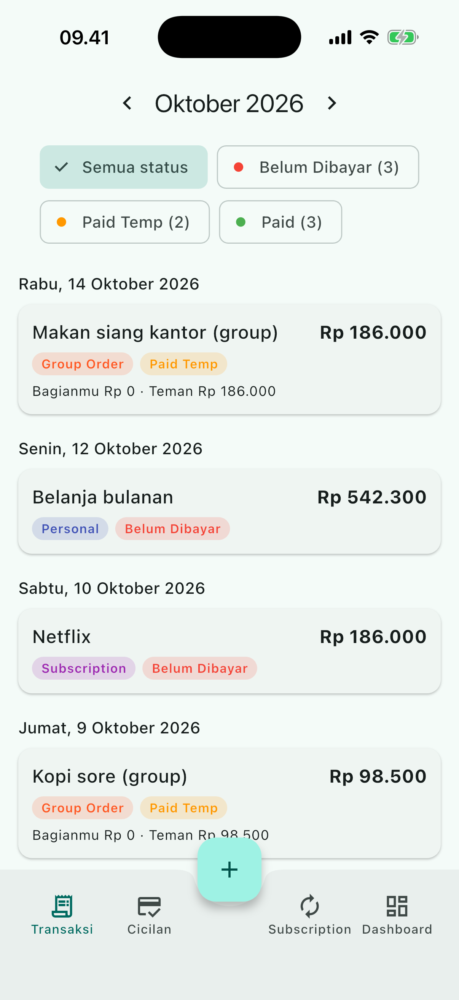
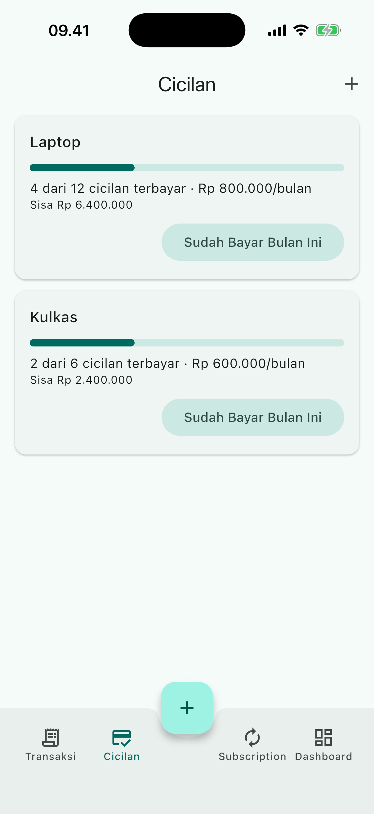
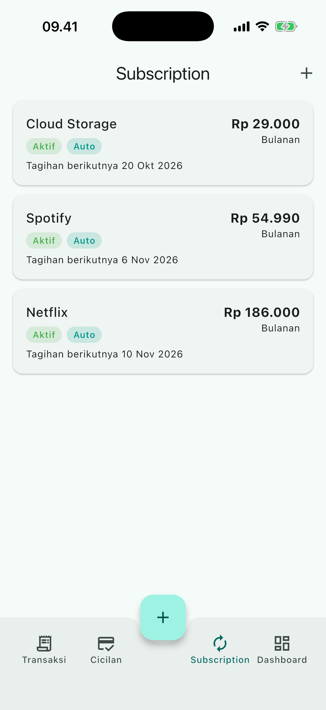
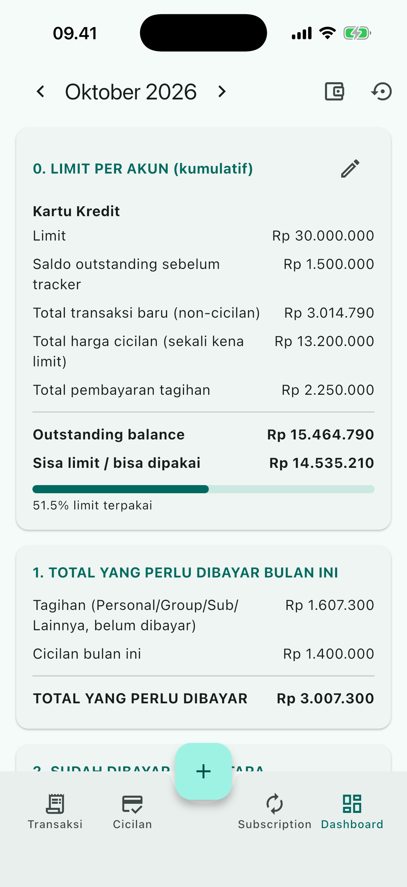

# CC Expense Tracker

**In short (English):** an offline-first Flutter app that tracks credit-card and pay-later spending. It assigns each purchase to the correct statement month using per-card cut-off dates, splits group orders between friends (optionally reading receipts with Google Gemini), and tracks installments and recurring subscriptions with local reminders. Built with Clean Architecture, BLoC, Drift (SQLite) and get_it, with 229 automated tests. The UI is in Indonesian because the app is built around Indonesian card and pay-later billing.

A personal Flutter app for tracking credit-card (and pay-later) spending, with first-class support for the things that make Indonesian card statements messy: statement cut-off dates, group orders that get split between friends, installments (cicilan) and recurring subscriptions.

It started as a Google Sheets tracker (`CC_Expense_Tracker.xlsx`) and was rebuilt as a mobile app. Everything is stored **locally on the device**. There is no backend and no account. The only network call is the optional AI receipt reader.

> The UI is in Indonesian. Code identifiers for domain concepts (`Transaksi`, `Akun`, `Cicilan`, ...) are Indonesian too.

## Screenshots

Sample data only (fictional names and amounts).

| Transactions | Installments | Subscriptions | Dashboard |
| --- | --- | --- | --- |
|  |  |  |  |

## Features

### Transaksi
- Record transactions with date, description, amount, type and payment status.
- Types: personal, group order, subscription, payment, other.
- Payment status per transaction: **Paid**, **Paid Temp** (paid on a friend's behalf, waiting to be reimbursed) and **Belum Dibayar** (unpaid).
- Filter by billing month, by account and by status, with live counts per status chip.
- Long-press for multi-select, then bulk-change status, with undo.

### Accounts (Akun)
- Multiple accounts: credit card, SPayLater and so on, each with its own credit limit, opening balance, statement cut-off day and payment due day.
- **Billing month** is derived from the account's cut-off day. For example, with a cut-off on the 4th, a purchase on 8 September lands on the September bill, and one on 3 September lands on August. A cut-off of `0` means the calendar month. You can override it manually per transaction (e.g. a bill for August paid on 10 September).

### Split bill
- Split a group order between participants, with a shared delivery fee divided evenly.
- Per-person payment status. Your own share has no status control; friends get a "Belum Dibayar" badge until settled.
- Remembers participant names and suggests them by usage frequency, with a searchable "+N more" sheet.
- **AI extraction (optional):** take a photo of a receipt or a screenshot of a group-chat order, and Gemini returns who owes what. Delivery and service fees are excluded and handled separately. You always review the result before saving, and a warning shows if the totals don't add up.

### Cicilan (installments)
- Track installments with tenor, monthly amount, start month and how many have been paid.
- One-tap "pay this month" (rejects paying the same month twice).

### Subscriptions
- Fixed-price or variable-price services, monthly or yearly billing, status active / inactive / cancelled.
- **Auto-generated bills:** every time the app opens, bills that have come due are created as transactions (and right after an import, without waiting for the next launch).

### Dashboard
- Credit limit position per account (cumulative, all-time).
- Amount due this month, split into card bills and installments.
- Temporarily-paid amounts, a breakdown by type, and your own spending vs. receivables from friends.
- Filter by account.

### Reminders
- Local notifications the day before a subscription is billed and the day before each account's payment due day.
- Scheduled at 09:00 device time, kept in sync automatically whenever data changes (save, delete, import, auto-generate). If too many are pending, the soonest take priority.
- Uses inexact alarms, so no exact-alarm permission is needed.

### Import and backup
- **Import** a JSON file, e.g. one produced from the original spreadsheet (see below).
- **Backup / restore** the whole database as JSON. Backups round-trip accounts, subscriptions, installments, transactions and splits.
- The importer validates the whole file before touching the database. Restoring replaces existing data after confirmation.

## Architecture

Clean-architecture layering with BLoC for state management.

```
lib/
├── core/
│   ├── di/            get_it service locator
│   ├── services/      reminder sync runner
│   ├── theme, utils, constants, error
├── data/
│   ├── database/      Drift (SQLite): tables, DAOs, migrations (schema v4)
│   ├── datasources/   Gemini split extractor, local notification scheduler
│   ├── repositories/  repository implementations
│   ├── import/        JSON parser, importer, backup exporter
│   └── models/        DB row <-> entity mappers
├── domain/
│   ├── entities/      Transaksi, Akun, Cicilan, Subscription, ...
│   ├── repositories/  abstract interfaces
│   ├── services/      abstractions (e.g. SplitExtractor)
│   └── usecases/      dashboard calculator, split calculator,
│                      reminder planners, bill generation, save/pay logic
└── presentation/
    ├── transaksi/ cicilan/ subscription/ dashboard/
    ├── akun/ split_bill/ import_data/
    └── common/widgets/
```

Each presentation feature has its own `bloc/`, `pages/` and `widgets/`. Business rules (billing month, split math, dashboard totals, reminder planning) live in plain-Dart use cases so they are easy to unit test.

### Tech stack

| Concern | Package |
| --- | --- |
| State management | `flutter_bloc`, `bloc_concurrency`, `equatable` |
| Local database | `drift` (SQLite) |
| Dependency injection | `get_it` |
| Notifications | `flutter_local_notifications`, `timezone`, `flutter_timezone` |
| AI receipt reading | Google Gemini REST API via `http` |
| Images / files | `image_picker`, `file_picker` |
| Config | `flutter_dotenv` |
| Testing | `flutter_test`, `bloc_test`, `mocktail`, `sqlite3` |

## Getting started

### Prerequisites
- Flutter with Dart SDK `^3.11.5`
- Android Studio / Xcode for device builds

### Setup

```bash
git clone https://github.com/gilangsatria09/cc_expense_tracker.git
cd cc_expense_tracker
flutter pub get

# Gemini key (optional, only needed for AI receipt extraction)
cp .env.example .env
# edit .env and set GEMINI_API_KEY=...

# only if you change Drift tables
dart run build_runner build --delete-conflicting-outputs

flutter run
```

`.env` is bundled as a Flutter asset, so it must exist for the app to build. It is git-ignored. Without a Gemini key everything works except AI extraction; manual entry is unaffected.

### API key security

`.env` is git-ignored, and no real key has ever been committed (only `.env.example` with an empty value is tracked). However, `.env` is bundled as a Flutter asset, so **the key is embedded in any APK/IPA you build and can be extracted from it**. That is acceptable for a personal build on your own device, but:

- do not distribute builds that contain your key;
- restrict the key in Google AI Studio / Cloud Console (quota limits, app restrictions);
- for a public release, move the call behind a small server-side proxy or let each user enter their own key at runtime instead of bundling one.

## Importing your spreadsheet data

`tool/xlsx_to_json.py` converts the original Google Sheets export into the JSON format the app imports.

```bash
python3 tool/xlsx_to_json.py CC_Expense_Tracker.xlsx import_data.json \
    --cutoff 4 \
    --cicilan-paid "Kursi=2,Vacuum cleaner=1" \
    --subs "Claude=349000@3,Hevy=45000@25"
```

Run it with `--help` (or read the docstring in the script) for all options, including data-correction flags and how installment counts and subscription links are inferred. `*.xlsx` and the generated `import_data.json` are git-ignored because they contain personal financial data. Then load the JSON from the app's import screen.

## Testing

```bash
flutter analyze
flutter test
```

The suite covers the database and migrations (v1 to v4), import/backup round-trips, the Gemini extractor, billing-month logic, dashboard calculations, reminder planning, and widget/flow tests for each feature.

## Data and privacy

All data stays in the app's local SQLite database. The only data that leaves the device is a receipt image sent to the Gemini API when you explicitly use AI extraction.

## License

Released under the [MIT License](LICENSE).

## Project status

Personal project, version `1.0.0`. Android and iOS targets are configured.
